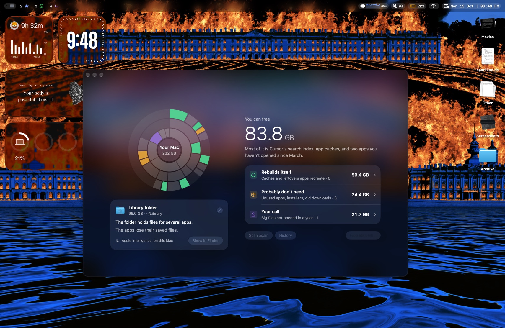

# Sweep

Sweep finds what's taking space on your Mac and explains it in plain language. Nothing leaves your Mac.



Open it, watch the scan, and Sweep sorts what it found into three groups:

- **Rebuilds itself:** app caches, render caches from video and photo apps, and old developer clutter. Ticked by default and cleaned with one click.
- **Probably don't need:** apps you haven't opened in months, leftovers from deleted apps, installers, duplicates, and downloads you never opened. These go to the Trash, so every removal can be undone.
- **Your call:** big files you haven't opened in a year, screenshots, and photos from Messages and WhatsApp. Sweep shows them and never removes them.

Click any part of the chart and Apple's on-device model explains what that folder is. There's no server, no account and no telemetry. Without Apple Intelligence everything still works; the explanations come from Sweep's own wording instead.

> Status: early. It works end to end on the author's Mac; the rules are being checked on more Macs. See [docs/status.md](docs/status.md).

## Install

1. Download [**Sweep.dmg**](https://github.com/notmehul/sweep/releases/latest/download/Sweep.dmg), open it, and drag Sweep into Applications.
2. Open Sweep. macOS will say it can't check it for malware, because this build isn't notarized by Apple yet. Click **Done**.
3. Open **System Settings → Privacy & Security**, scroll to "Sweep was blocked", and click **Open Anyway**. You only do this once.
4. When Sweep asks, allow **Full Disk Access** so it can see app data in your Library.

Needs macOS 26 or later on an Apple Silicon Mac. Every release is listed on the [releases page](https://github.com/notmehul/sweep/releases).

## Build from source

Requires macOS 26+ on Apple Silicon and the Command Line Tools (`xcode-select --install`). Xcode isn't needed.

```sh
swift test          # engine, rules and safety tests
scripts/run.sh      # build, sign and open build/Sweep.app
```

Want to read the code? Start with [CONTRIBUTING.md](CONTRIBUTING.md).

## License

MIT. See [LICENSE](LICENSE).
